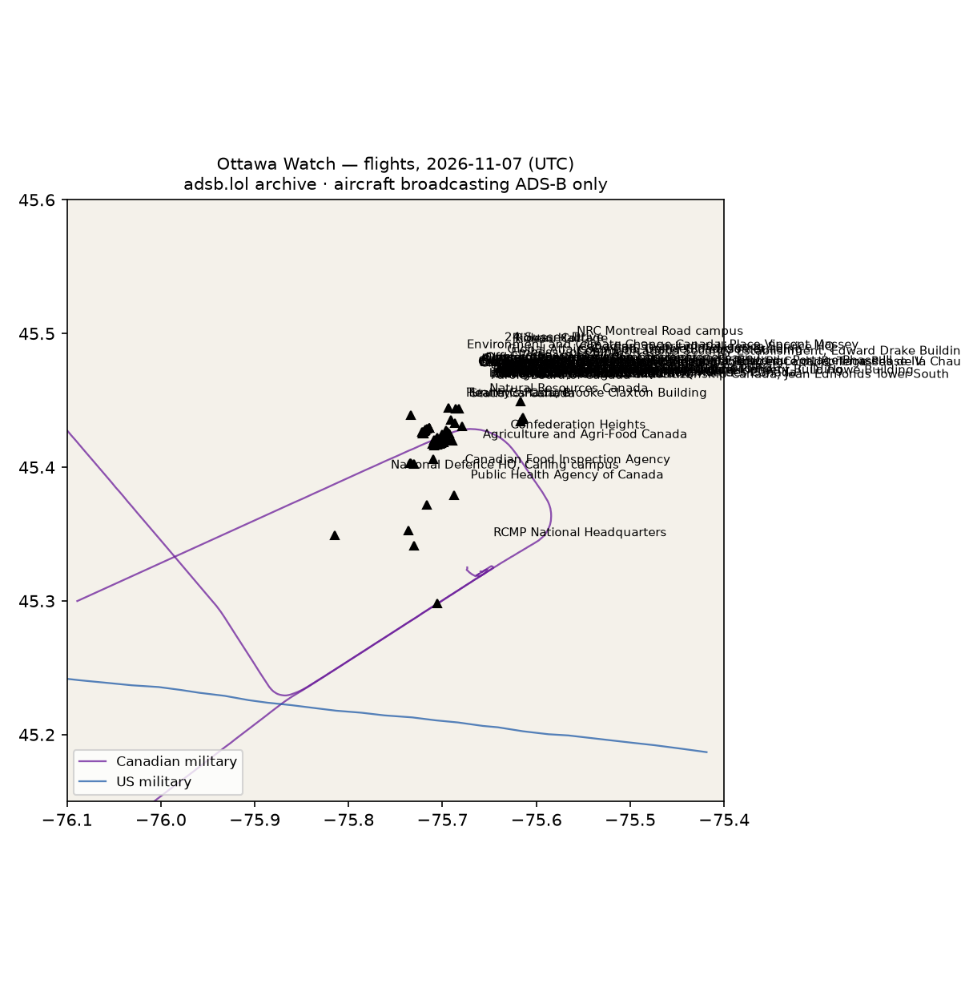

# RWI-W-OTTAWA-2026-11-08 — Ottawa Watch

*Ottawa–Gatineau federal buildings. Daily open-source look; flights for 2026-11-07 (UTC), heat for 2026-11-07–2026-11-08, newest satellite passes. LLM-generated and automated.*

## Notable

- Nothing out of pattern.

## Flights

5 aircraft kept: 1 US military, 3 Canadian military, 0 foreign military, 0 state/VIP, 1 other (on the ground at a site, or near a range).

### US military

C17 ×1.

### Canadian military

- 144618 CL60 CFC3120 22:47–22:58 UTC — used Ottawa Macdonald-Cartier (CYOW) 22:54 UTC
- 330004 A332 CFC3421 04:26–04:43 UTC — used Ottawa Macdonald-Cartier (CYOW) 04:33 UTC
- 144620 CL60 CFC01 CHAL20 18:14–19:52 UTC — used Ottawa Macdonald-Cartier (CYOW) 18:14 UTC

### Foreign military

None broadcasting.

### Landings and low passes by site

| Site | Military / government aircraft on the ground or ≤1,500 ft within 4 km; civil count |
|---|---|
| Centre Block (Parliament) | — |
| West Block (House of Commons, interim chamber) | — |
| East Block | — |
| Senate of Canada Building (former Government Conference Centre) | — |
| Office of the Prime Minister and Privy Council (former Langevin Block) | — |
| 24 Sussex Drive (official PM residence) | — |
| Rideau Cottage (current PM residence) | — |
| Rideau Hall (Governor General) | — |
| Supreme Court of Canada Building | — |
| Supreme Court of Canada (interim, West Memorial Building) | — |
| National Defence HQ, Carling campus | — |
| Maj.-Gen. George R. Pearkes Building (legacy NDHQ) | — |
| Global Affairs Canada, Lester B. Pearson Building | — |
| Department of Finance, James Michael Flaherty Building | — |
| Treasury Board of Canada Secretariat | — |
| Department of Justice, East Memorial Building | — |
| Innovation, Science and Economic Development, C.D. Howe Building | — |
| Health Canada, Brooke Claxton Building (Tunney's Pasture) | — |
| Public Health Agency of Canada | — |
| Employment and Social Development Canada, Place du Portage Phase IV | — |
| Immigration, Refugees and Citizenship Canada, Jean Edmonds Tower South | — |
| Transport Canada, Place de Ville Tower C | — |
| Natural Resources Canada | — |
| Environment and Climate Change Canada, Place Vincent Massey | — |
| Fisheries and Oceans Canada | — |
| Agriculture and Agri-Food Canada (NHCAP, Central Experimental Farm) | — |
| Crown-Indigenous Relations / Indigenous Services Canada, Terrasses de la Chaudiere | — |
| Canadian Heritage, Jules Leger Building (Terrasses de la Chaudiere) | — |
| Public Services and Procurement Canada, Place du Portage Phase III | — |
| Housing, Infrastructure and Communities Canada | — |
| Women and Gender Equality Canada | — |
| Communications Security Establishment, Edward Drake Building | — |
| Canadian Security Intelligence Service HQ | — |
| RCMP National Headquarters | — |
| Public Safety Canada | — |
| Canada Border Services Agency HQ | — |
| FINTRAC | — |
| Canadian Coast Guard HQ | — |
| Correctional Service Canada NHQ | — |
| Parole Board of Canada | — |
| Canadian Food Inspection Agency | — |
| Statistics Canada (Main Building / R.H. Coats, Tunney's Pasture) | — |
| Bank of Canada | — |
| Elections Canada | — |
| Library and Archives Canada | — |
| Canada Revenue Agency, Connaught Building | — |
| Shared Services Canada | — |
| Office of the Information Commissioner | — |
| Office of the Privacy Commissioner | — |
| Office of the Auditor General | — |
| Competition Bureau, Place du Portage Phase I | — |
| CRTC, Terrasses de la Chaudiere (Central Building) | — |
| Canadian Nuclear Safety Commission | — |
| Tunney's Pasture | — |
| Confederation Heights | — |
| Place du Portage I-IV | — |
| Les Terrasses de la Chaudiere | — |
| NRC Montreal Road campus | — |
| CSE / CSIS Ogilvie Road cluster | — |
| Embassy of the United States | — |
| British High Commission | — |
| Embassy of China | — |
| Embassy of Russia | — |
| Ottawa downtown core (Parliament, Wellington, Sparks, Laurier) | — |
| Gatineau federal district (Place du Portage, Terrasses de la Chaudière, 30 Victoria) | — |

## Heat

0 detections in the watch box (FIRMS area API (agent Gazda)); 0 inside a site box. Rockcliffe and Ottawa Macdonald-Cartier (CYOW) are inside the flight box; a low aircraft over the core or the Ogilvie Road (CSE/CSIS) cluster is what to look for.

## Imagery

| Site | Newest clear Sentinel-2 pass (≤12 days) | |
|---|---|---|
| 24 Sussex Drive (official PM residence) | 2026-11-08 16:10 UTC, 100% clear | [new plate](S2_ott-24-sussex.jpg) |
| Rideau Hall (Governor General) | 2026-11-08 16:10 UTC, 100% clear | [new plate](S2_ott-rideau-hall.jpg) |
| Tunney's Pasture | 2026-11-08 16:10 UTC, 99% clear | [new plate](S2_ott-campus-tunneys-pasture.jpg) |
| Confederation Heights | 2026-11-08 16:10 UTC, 99% clear | [new plate](S2_ott-campus-confederation-heights.jpg) |
| CSE / CSIS Ogilvie Road cluster | 2026-11-08 16:10 UTC, 96% clear | [new plate](S2_ott-campus-ogilvie-intel.jpg) |
| Ottawa downtown core (Parliament, Wellington, Sparks, Laurier) | 2026-11-08 16:10 UTC, 99% clear | [new plate](S2_ott-downtown-core.jpg) |
| Gatineau federal district (Place du Portage, Terrasses de la Chaudière, 30 Victoria) | 2026-11-08 16:10 UTC, 99% clear | [new plate](S2_ott-gatineau-core.jpg) |

